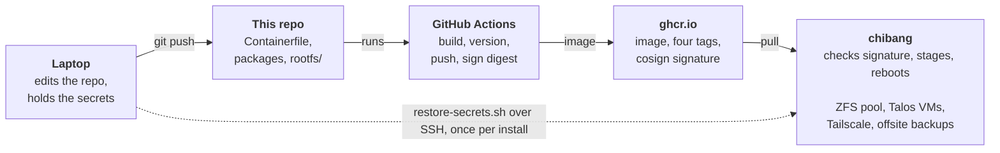

# chibang

chibang is my home server. It holds the ZFS storage pool, keeps the restic backup repository and copies it offsite every night, and hosts the Talos Kubernetes VMs defined in [k8s-infra](https://github.com/edy-rus/k8s-infra).

Its whole operating system is a container image built from this repo. GitHub Actions builds and signs the image, and the server checks the signature, stages the new image and boots into it on the next reboot. Nothing important is configured by logging in and typing commands.

The one idea to hold on to: **the OS is an artefact, not a place you work in.** You change the repo, a new image is built, and the server swaps its whole OS for the new one. The previous version stays on disk as a fallback.

For the story of why it is built this way, see the write-up [Chibang - A GitOps-Managed Home Server for Kubernetes](https://edy.tarbide.com/projects/gitops-managed-home-server/).



Changes flow one way, from the repo to the host. Secrets take the only other path, straight from the laptop over SSH.

## The Foundations

| Layer | What it is | What it gives chibang |
|---|---|---|
| **Fedora CoreOS** | Fedora for servers, immutable and self-updating | A read-only `/usr`, automatic updates, Ignition for first boot |
| **rpm-ostree** | Manages the OS as whole versioned trees | Atomic updates and one-command rollback |
| **bootc** | The OS packaged as an ordinary container image | Build the OS with a Containerfile, host it in any registry |
| **[uCore HCI](https://projectucore.org)** | Fedora CoreOS with extras baked in | ZFS, KVM/libvirt, Tailscale, restic and rclone |

### Which Directories Are Which

This rule decides where every file in `rootfs/` goes.

- **`/usr` is the image.** Read-only on the host and replaced on every update. Anything shipped goes here, which is why units live in `/usr/lib/systemd/system` and not `/etc/systemd/system`.
- **`/etc` is config that merges.** It starts as the image's copy. Local edits survive updates and are merged with the new image's defaults.
- **`/var` is state.** Updates never touch it. The pool mount, VM disks and logs live here.

## The Repo, File by File

```
Containerfile        image = ucore-hci:stable + packages.txt + rootfs/
packages.txt         extra host packages, one per line
rootfs/              files copied onto / (units, firewall zones, network
                     profiles, polkit rule, sysctl, scripts, signing public key)
ignition/chibang.bu  first-boot config (Butane): SSH key, hostname, rebase to the image
restore-secrets.sh   puts the secrets back on the host after an install
.github/workflows/   build.yml: builds, versions, pushes and signs the image
                     validate-ignition.yml: butane --strict on ignition/*.bu
.github/dependabot.yml  weekly PRs for the pinned actions
```

### Containerfile

Each step adds one thing to the image:

1. **`FROM ucore-hci:stable`.** Tracking the `stable` tag means a rebuild picks up upstream fixes with no change here.
2. **Packages** from `packages.txt`, then `/var/cache` and `/var/log` are cleared, because state belongs to the host, not the image.
3. **`COPY rootfs/ /`.** The folder mirrors the real filesystem.
4. **`chmod 600` on the NetworkManager profiles.** NetworkManager ignores keyfiles that are not 0600, and git cannot store that.
5. **Signature policy.** Adds a rule to `/etc/containers/policy.json` that images named `ghcr.io/edy-rus/chibang` must be signed by the key in `rootfs/etc/pki/containers/`.
6. **`systemctl enable`** for the units in `rootfs/`.
7. **Ordering-cycle check.** The build fails if `systemd-analyze verify` finds one. At boot systemd "solves" a cycle by dropping a unit, which can leave the host half up and unreachable.
8. **`bootc container lint`** checks the result is a valid bootable image.

### rootfs/

| Area | Files | What they do |
|---|---|---|
| ZFS | `zfs-firstboot-import.service`, `chibang-zfs-load-key.service` | Import the existing pool once, then load encryption keys before mounting on every boot |
| Backups | `restic-offsite.{service,timer}`, `restic-offsite.sh` | Mirror the restic repository offsite every night, after checking it is safe to |
| Network | `br0.nmconnection`, `br0-port.nmconnection`, `50-br0.link` | A `br0` bridge over whatever wired NIC exists, so VMs sit on the LAN |
| libvirt | `50-libvirt-core.rules` | Lets the admin user manage libvirt over SSH without a password prompt |
| Tailscale | `tailscale-init.service`, `99-tailscale.conf` | Joins the tailnet on first boot, turns on forwarding |
| Firewall | `firewalld/zones/*.xml` | Only what the host needs is open on the LAN, the tailnet is trusted |
| Trust | `etc/pki/containers/chibang.pub` | The public key updates are verified against |

## What Runs on the Host

### ZFS

The pool already exists on the HDDs. The OS never creates it, it only imports and unlocks it, so a reinstall wipes the SSD and leaves the data untouched.

- The first-boot import runs only when `/etc/zfs/zpool.cache` is missing, imports by `/dev/disk/by-id`, and writes the cache. After that the stock import unit takes over.
- uCore's own `zfs-load-key.service` is an empty stub, so `chibang-zfs-load-key.service` loads the keys. Until the key is restored it fails, and only the encrypted dataset stays locked.
- Both run with `DefaultDependencies=no`, because mounting is needed before `basic.target`. Without it they create the ordering cycle the build checks for.

### Backups

Clients back up into a restic repository on the pool. A timer copies that repository offsite every night, and a missed run happens at the next boot. Before it copies, the script checks that the local repository exists, that no backup or prune holds a lock, and that the remote is the same repository. The copy is a mirror (deletions included), which is why those checks matter.

### Network

The NIC is a port of the `br0` bridge, and the host's IP lives on the bridge. Nothing in the image names a NIC, MAC or IP address:

- The port profile matches any wired interface (`en*`).
- The bridge takes the NIC's MAC address, because systemd would otherwise give it one derived from the machine-id, which changes on every reinstall. So the router's DHCP reservation keeps matching.
- STP is off: one uplink means no loops, and it saves 15 to 30 seconds at boot.

### Firewall

The LAN zone allows SSH and nothing else the host does not need. The Tailscale interface is in the trusted zone, so admin access happens over the tailnet. Keep firewall changes in the repo, since `firewall-cmd --permanent` writes to `/etc` and would override it.

## The Build Pipeline

`build.yml` runs on a push that touches the image (Containerfile, `packages.txt`, `rootfs/` or the workflow), once a day to pick up upstream uCore, and by hand.

1. **Version.** `<Fedora major>.<YYYYMMDD>.<n>`, for example `45.20261124.0`, where `n` counts the builds that day. If the tag listing fails the job fails, because guessing could overwrite a tag that must never change. Builds are queued, never run side by side, for the same reason.
2. **Build** with OCI labels for the version, build time, git commit and the uCore base digest. These trace any running image back to its exact commit.
3. **Push** one image under four tags.
4. **Sign** the digest with cosign. One signature covers every tag, because they all point at the same digest.

Actions are pinned to commit SHAs, not tags, and Dependabot keeps them current. It holds back major versions of `cosign-installer`, because cosign 3 may write signatures the host cannot verify yet.

`validate-ignition.yml` runs `butane --strict` on every change to `ignition/`. Ignition reads Butane without strict checks at boot, so a typo would otherwise show up as a half-provisioned machine.

## Updates and Rollback

An update never changes the running system. The host stages it beside the current one, and it becomes live on the next reboot. chibang does not reboot itself, so I choose when the VMs go down. `rpm-ostree status` shows what is booted and what is staged.

| Tag | Moves? | Use |
|---|---|---|
| `stable` | yes | what chibang tracks |
| `45` | yes | latest build on Fedora 45 |
| `stable-20261124` | yes, within the day | last build of that day |
| `45.20261124.0` | no | pin or roll back to an exact build |

One step back is `sudo rpm-ostree rollback` and a reboot, or the older entry in the boot menu. To go further back:

```
sudo rpm-ostree rebase ostree-image-signed:docker://ghcr.io/edy-rus/chibang:45.20261122.0
# later, back to tracking:
sudo rpm-ostree rebase ostree-image-signed:docker://ghcr.io/edy-rus/chibang:stable
```

The timestamp `rpm-ostree status` prints beside the version is inherited from upstream, not the build time. `skopeo inspect` on the version tag shows the real `created` time and git `revision`.

## Installing

The same steps work on bare metal or in a VM:

> [!WARNING]
> The install erases the target disk. Point it at the OS SSD by its `/dev/disk/by-id/` path, never at a pool member, since `/dev/sdX` names can change between boots. The ZFS pool on the HDDs is not touched.

```
sudo coreos-installer install /dev/disk/by-id/<os-ssd> \
  --ignition-url https://raw.githubusercontent.com/edy-rus/chibang/main/ignition/chibang.bu
```

coreos-installer 0.27.0 and later accept Butane YAML directly. An older installer fails with "not a valid Ignition JSON config". In that case, render the config once and pass the file:

```
docker run --rm -i quay.io/coreos/butane:release --strict < ignition/chibang.bu > chibang.ign
sudo coreos-installer install /dev/disk/by-id/<os-ssd> --ignition-file chibang.ign
```

Ignition runs once, on the first boot only, so configuration never goes there. It belongs in `rootfs/` or the Containerfile.

### The Three Boots

Stock Fedora CoreOS does not have the signing key, so it cannot verify the image until it is running the image. The install gets around that in three boots, with no input:

1. **Stock Fedora CoreOS** rebases to the image unverified, leaves a marker in `/etc`, and reboots.
2. **chibang, unverified.** Now the policy and public key are present, so it rebases to the signed image, leaves a second marker, and reboots.
3. **chibang, signed.** Both markers exist, so neither step runs again. Every update from here on is verified.

### When the Boots Stall

Each step writes its marker only after its rebase succeeds. A failed rebase leaves the host up on the system it already has, with no reboot, and the step runs again on the next boot. Log in over SSH and see how far it got:

```
ls /etc/ucore-autorebase/      # no marker: step 1 failed, unverified only: step 2 failed
rpm-ostree status              # what is booted and what is staged
journalctl -b -u ucore-unsigned-autorebase -u ucore-signed-autorebase
```

The usual causes are no network at boot, the registry being unreachable, or, on step 2, a signature that does not verify against the key in the image. Once the cause is fixed, run the step by hand with `sudo systemctl start ucore-signed-autorebase` (or the unsigned one). It rebases and reboots exactly as it would have at boot.

If a step did reboot but the new system will not come up or is unreachable on the network, pick the previous entry in the boot menu. That is the system the step started from, still intact. Read the failed boot's log with `journalctl -b -1` from there.

For a test VM, copy `ignition/chibang.bu`, change the hostname, push it and install from that URL. Otherwise the VM shows up as a second chibang on the LAN and the tailnet.

## Secrets and Trust

The image and this repo are public, so they must be useless to a stranger. Public things go in the image, secrets stay in my password store, and the host only gets secrets after it is up.

| Item | Secret? | Where it lives |
|---|---|---|
| SSH public key | no | `ignition/chibang.bu` |
| Image-signing public key | no | in the image |
| Image-signing private key | yes | password store, and a repository secret for CI |
| ZFS encryption key, offsite credentials | yes | password store, restored after install |

Once the host is up on the signed image (`rpm-ostree status` shows `ostree-image-signed:...`), run this from the admin machine:

```
./restore-secrets.sh
```

It copies the secrets from the password store over SSH, unlocks the encrypted dataset and mounts it. The secrets land in `/etc` and the home directory, which updates never replace, so this is once per install. After a reinstall, clear the old host key first with `ssh-keygen -R <host>`.

Then check:

```
systemctl --failed
zfs get -H keystatus
systemctl list-timers restic-offsite.timer
```

### The Chain of Trust

Only CI holds the private key. It signs the digest of every image it pushes. The image carries the public key and a policy that chibang images must be signed by it, and rpm-ostree checks that policy before staging any update. So a hijacked registry account or a moved tag cannot put someone else's OS on the server. The weak points left are the GitHub account and the repository secret.

To rotate the signing key, first ship an image that trusts both the old and new keys, let the host take it, then switch CI to the new key, then drop the old one. The host checks each update with the policy it is running now, so switching in one step locks it out of updates.
